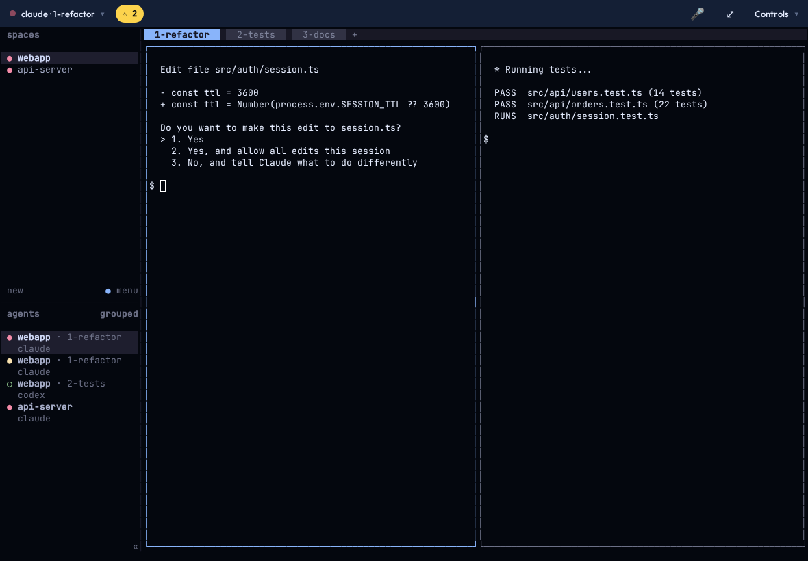
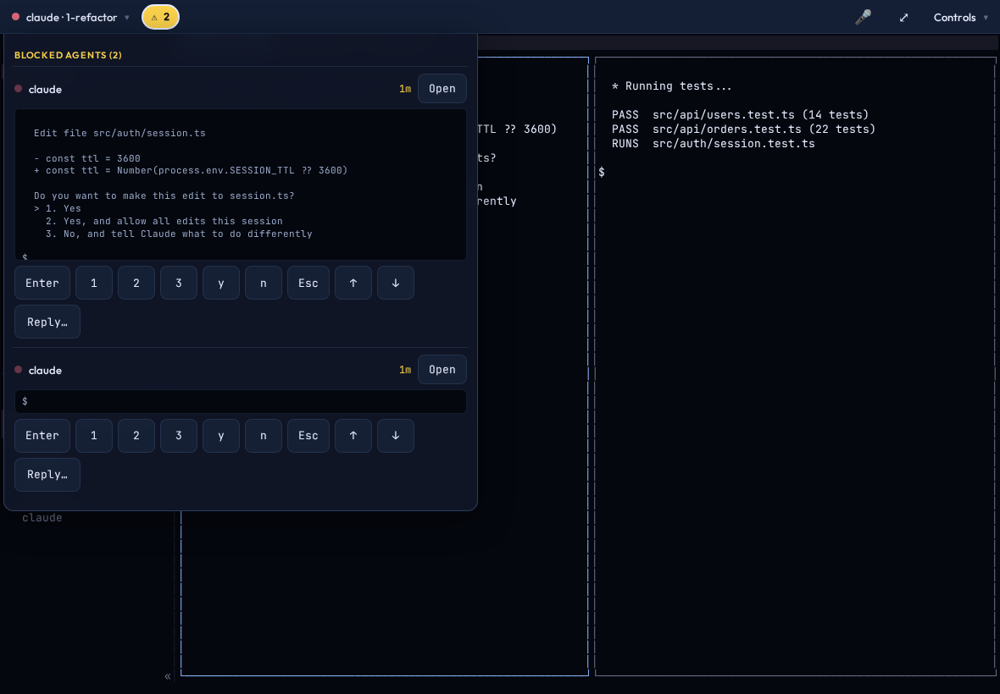
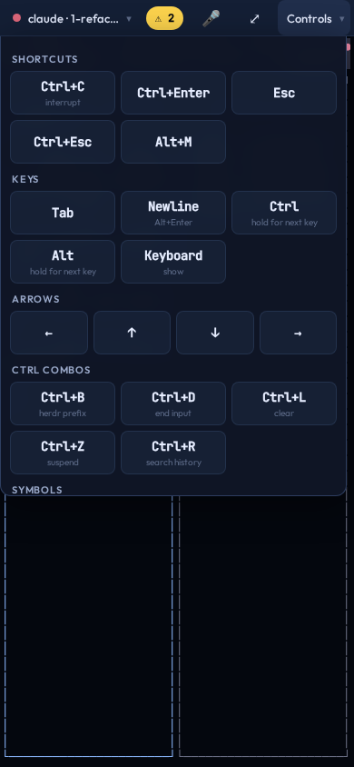
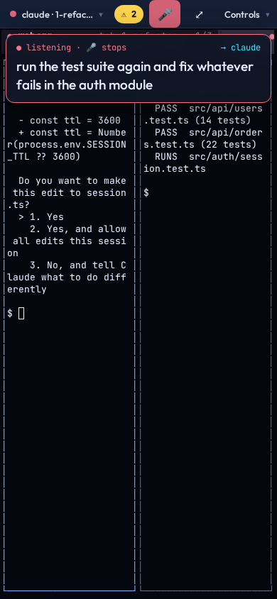

# Wheelhouse — herdr in your browser and on your phone

Wheelhouse is a web client for [herdr](https://herdr.dev), the terminal workspace
for coding agents. It shows your **whole herdr session exactly as herdr draws it**:
sidebar, tabs, splits, agent status. Then it adds the things a phone needs to
actually drive agents from the couch.



## What it does

- **The real herdr TUI.** The server runs a genuine `herdr` client in a PTY and
  streams it to xterm.js, so nothing is re-implemented and nothing is missing.
- **Phone keys without the keyboard.** A Controls menu with spelled-out keys and
  captions: Esc, Tab, Ctrl+C, Ctrl+Enter, Alt+Enter newline, sticky Ctrl/Alt,
  arrows, Ctrl combos and symbols, with an optional pinned tray.
- **Dictation.** Tap 🎤 and speak. Your words go to the pane you started in
  (by pane ID, so a focus change can't misroute them), then Enter follows after
  10 seconds. Tap again to cancel the Enter. Uses the browser's own speech
  recognition (Safari on iOS: Apple's).
- **Image paste.** Paste a screenshot (Ctrl+V, Ctrl+Shift+V, Cmd+V, or Controls ›
  Paste on a phone). The server saves it and pastes its file path, which Claude
  Code shows as `[Image #1]`; other agents can open the file. Saved under
  `<state dir>/uploads`, kept 7 days.
- **Blocked-agent inbox.** A ⚠ badge counts agents waiting on you. The inbox shows
  each one's last lines with one-tap answers (Enter, 1/2/3, y/n, Esc, arrows) or
  a reply, all sent to that pane without moving your focus.
  
- **Push notifications.** Get a notification when an agent goes blocked, even
  with the app closed. Tap it to land on the inbox. Works in an iOS home-screen
  app (16.4+), Android and desktop browsers.
- **Touch scrollback** through herdr's own history, a "↓ N up" chip to get back,
  copy-on-select (OSC 52), clickable links (including OSC 8 hyperlinks).
- **Survives bad networks:** heartbeat, zombie-socket detection and fast
  reconnect when the phone wakes or changes networks.
- **Read-only by default.** Typing is off until you set `HERDRWEB_ENABLE_WRITES=1`.

<p align="center">
</p>

## ⚠ Security model: there is no login

Anyone who can reach the port can type into every pane, which means **a shell as
you**. Wheelhouse does not add a password. Instead, keep it off the open
internet:

- bind it to `127.0.0.1` (the default) behind a reverse proxy on your LAN, or
- reach it over a mesh VPN (Tailscale, NetBird, Twingate, WireGuard), or
- if you must use a public tunnel, put an identity gate in front of it
  (for example Cloudflare Tunnel **plus Cloudflare Access**).

**[docs/NETWORKING.md](docs/NETWORKING.md)** walks through each option. Two
guards stop other web pages from driving it through your browser: the server
only answers to host names you list (`HERDRWEB_ALLOWED_HOSTS`, which blocks DNS
rebinding), and it refuses WebSocket and API calls whose `Origin` is another site.

## Install

Requirements: Linux or macOS with herdr ≥ 0.8, Python ≥ 3.10, Node ≥ 18.

```bash
git clone https://github.com/<you>/wheelhouse && cd wheelhouse
deploy/install.sh
```

That builds the app, writes `~/.config/herdr-web/env` (localhost only, read-only)
and starts a `systemd --user` service. Edit the env file to turn on typing
(`HERDRWEB_ENABLE_WRITES=1`), add the host name you'll use from your phone to
`HERDRWEB_ALLOWED_HOSTS`, or pick a session, then
`systemctl --user restart herdr-web`. On macOS, or to run it by hand:

```bash
deploy/install.sh --build
cd backend && HERDRWEB_ENABLE_WRITES=1 .venv/bin/uvicorn app.main:app --port 8086
```

Phones need HTTPS for the microphone, clipboard and push notifications. See
[docs/NETWORKING.md](docs/NETWORKING.md).

### On iPhone / iPad

Open the site in Safari, then Share › **Add to Home Screen**, and use that icon.
Push notifications only work from the home-screen app (Controls › Notifications ›
Turn on). The first 🎤 tap asks for microphone permission.

## Configuration

All settings are environment variables, each documented in
[`backend/.env.example`](backend/.env.example): herdr binary and session, bind
address and port, writes on/off, allowed host names and origins, terminal limit,
and the push settings (state directory, contact, private mode, endpoint hosts).

## How it works

[docs/ARCHITECTURE.md](docs/ARCHITECTURE.md) explains it, and [docs/API.md](docs/API.md)
lists the endpoints. In short: FastAPI serves the React app, bridges a herdr client in a
PTY over a WebSocket, relays herdr's event stream, and sends Web Push when an agent
becomes blocked.

## Related projects

Two other herdr web clients take a different approach: both render one pane at a
time and rebuild herdr's UI in React. Look at them if you want that model:
[kcosr/herdr-web](https://github.com/kcosr/herdr-web) (Rust, Android app, needs herdr ≥ 0.9) and
[narumiruna/herdr-web](https://github.com/narumiruna/herdr-web) (Node, tokens/roles, Docker).

## License

MIT. Not affiliated with herdr.
